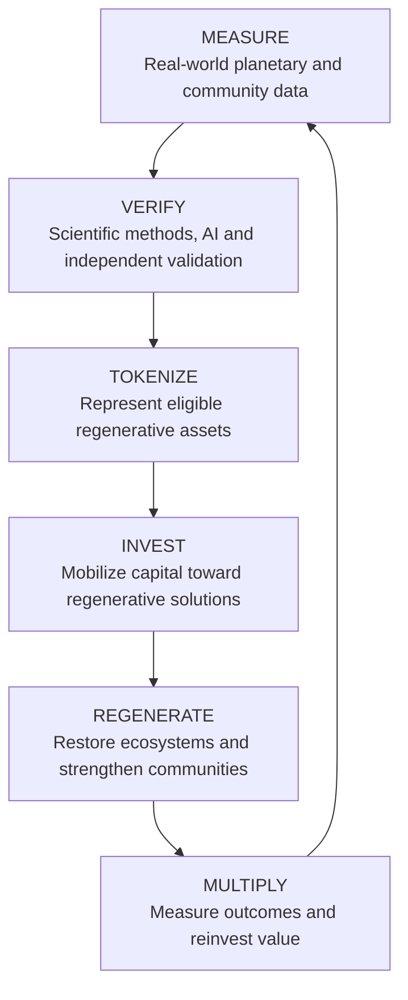
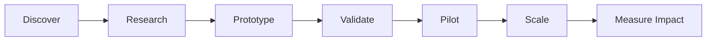

# 🌍 ATLAS SANCTUM
## The Regenerative Value Platform

### Regenerating Our Planet. Empowering Humanity. Multiplying Value for All Life.

  <strong>ONE PLANET. ONE INTERCONNECTED ECONOMY. A REGENERATIVE FUTURE.</strong>

  <a href="#-vision">Vision</a> •
  <a href="#-platform-architecture">Architecture</a> •
  <a href="#-ecosystems">Ecosystems</a> •
  <a href="#-regenerative-value-exchange">Value Exchange</a> •
  <a href="#-impact-intelligence">Impact Intelligence</a> •
  <a href="#-roadmap">Roadmap</a>

---

## 🌱 01. The Vision

Humanity's economic systems have become remarkably effective at creating, exchanging, and accumulating financial value.

Yet the natural systems, communities, and living ecosystems that sustain civilization remain undervalued.

Atlas Sanctum is envisioned as a regenerative value platform designed to bridge this divide.

It brings together ecosystems, knowledge, capital, innovation, technology, and communities into an interconnected infrastructure for planetary regeneration.

Our ambition is to create an economic environment where:

- Nature becomes visible within economic decision-making.
- Regenerative activities generate measurable value.
- Capital flows toward solutions that restore ecosystems and improve lives.
- Scientific knowledge accelerates sustainable innovation.
- Communities participate in the value they help create.
- Environmental and social outcomes become transparent and verifiable.
- Regenerative prosperity becomes a foundation for long-term economic development.

**We believe the future economy must do more than reduce harm. It must actively restore, replenish, and regenerate.**

---

## 🌍 02. Our Mission

Atlas Sanctum exists to unite the world's regenerative capabilities into one interconnected platform.

Our mission is to accelerate the transition toward a regenerative civilization by connecting:

| Pillar | Purpose |
|---|---|
| Ecosystems | Restore and protect natural systems |
| Knowledge | Democratize scientific and practical knowledge |
| Capital | Mobilize investment toward regenerative solutions |
| Innovation | Accelerate breakthrough technologies |
| Communities | Empower people and local institutions |
| Intelligence | Measure, verify, and optimize impact |
| Governance | Enable transparent and accountable coordination |

Our long-term objective is to create a platform through which humanity can understand the state of planetary wellbeing, identify opportunities for regeneration, mobilize resources, and measure the resulting impact.

---

# 🏛️ 03. Platform Architecture

Atlas Sanctum is organized into interconnected operational environments.

```mermaid
flowchart TD
    A["ATLAS SANCTUM<br/>Regenerative Value Platform"]

    A --> B["Ecosystem Intelligence"]
    A --> C["Regenerative Economy"]
    A --> D["Knowledge & Innovation"]
    A --> E["Institutional Coordination"]
    A --> F["Impact Intelligence"]

    B --> B1["Regenerative Agriculture"]
    B --> B2["Ocean & Blue Economy"]
    B --> B3["Climate & Restoration"]
    B --> B4["Human Health"]
    B --> B5["Circular Bioeconomy"]

    C --> C1["Regenerative Value Exchange"]
    C --> C2["Investment Hub"]
    C --> C3["Project Marketplace"]

    D --> D1["Knowledge Hub"]
    D --> D2["Innovation Labs"]

    E --> E1["Community"]
    E --> E2["Governance"]
    E --> E3["Institutional Partnerships"]

    F --> F1["Planetary Monitoring"]
    F --> F2["Impact Verification"]
    F --> F3["Data & Analytics"]

    B --> G["Regenerative Prosperity"]
    C --> G
    D --> G
    E --> G
    F --> G
```

## 🧭 04. Platform Navigation

The Atlas Sanctum command environment provides a unified interface for exploring and coordinating regenerative activity.

| Module | Function |
|---|---|
| Home | Global regenerative intelligence overview |
| Mission Control | Central operational dashboard |
| Ecosystems | Explore regenerative sectors and projects |
| Regenerative Value Exchange | Discover and exchange regenerative value |
| Impact Intelligence | Monitor and evaluate real-world impact |
| Knowledge Hub | Access research, data, and best practices |
| Innovation Labs | Develop and accelerate regenerative technologies |
| Investment Hub | Discover and fund regenerative ventures |
| Community | Connect participants and organizations |
| Governance | Participate in platform decision-making |
| Data & Analytics | Analyze planetary and economic indicators |
| Developers | Access technical resources and integrations |
| System Settings | Configure platform preferences and operations |

---

# 🌿 05. Global Regenerative Ecosystems

Atlas Sanctum recognizes that planetary regeneration requires coordinated action across interconnected natural, economic, and human systems.

The platform establishes dedicated ecosystems for major regenerative sectors.

## I. Regenerative Agriculture

Transform agricultural production into a system that restores soil health, strengthens biodiversity, improves water management, and supports resilient food systems.

Focus areas:

- Agroecology.
- Agroforestry.
- Regenerative livestock systems.
- Soil carbon restoration.
- Precision agriculture.
- Sustainable food production.
- Indigenous agricultural knowledge.
- Water-efficient farming.

## II. Ocean & Blue Economy

Protect marine ecosystems while unlocking sustainable economic opportunities across ocean-dependent communities.

Focus areas:

- Marine biodiversity.
- Mangrove restoration.
- Coral reef protection.
- Sustainable fisheries.
- Blue carbon.
- Ocean monitoring.
- Coastal resilience.
- Marine biotechnology.

## III. Human Health & Wellness

Connect environmental wellbeing, public health, nutrition, and human development.

Focus areas:

- Preventive healthcare.
- Nutrition and food security.
- Environmental health.
- Community wellbeing.
- Water and sanitation.
- Healthcare innovation.
- Health research.
- Equitable access to care.

## IV. Circular Bioeconomy

Transform waste and biological resources into productive inputs for sustainable economic systems.

Focus areas:

- Industrial biotechnology.
- Biomaterials.
- Waste valorization.
- Circular manufacturing.
- Bioenergy.
- Biodegradable materials.
- Resource recovery.
- Sustainable supply chains.

## V. Climate Action & Restoration

Accelerate climate mitigation, adaptation, and restoration through measurable interventions.

Focus areas:

- Reforestation and afforestation.
- Carbon removal.
- Ecosystem restoration.
- Renewable energy.
- Climate adaptation.
- Biodiversity conservation.
- Nature-based solutions.
- Climate resilience infrastructure.

---

# 💎 06. Regenerative Value Exchange
### Transparent. Verifiable. Regenerative.

The Regenerative Value Exchange is the economic coordination layer of Atlas Sanctum.

Its purpose is to connect regenerative projects with capital, knowledge, technology, partners, and communities.

Rather than treating economic growth as an end in itself, the platform explores ways to make the creation of economic value increasingly compatible with ecological restoration and human prosperity.

### The Regenerative Value Cycle

### Six Stages of Regenerative Value Creation

**01. Measure**

Collect environmental, economic, and social information from credible data sources.

**02. Verify**

Evaluate the integrity, provenance, and reliability of impact evidence.

**03. Tokenize**

Explore digital representations of eligible regenerative assets and verified claims, subject to applicable legal and environmental standards.

**04. Invest**

Connect investors, institutions, and funding partners with regenerative opportunities.

**05. Regenerate**

Support measurable ecological restoration, resilient livelihoods, and community development.

**06. Multiply**

Evaluate outcomes, improve interventions, and direct additional resources toward successful regenerative solutions.

### Foundational Economic Principle

Value should be measured not only by what an activity produces financially, but also by what it contributes to the long-term health of people and the planet.

---

# 🛰️ 07. Impact Intelligence
### Making Planetary Progress Measurable

Impact Intelligence is the analytical and verification environment of Atlas Sanctum.

It is designed to transform complex environmental and socioeconomic information into understandable, actionable insights.

### Key Intelligence Domains

| Domain | Intelligence Focus |
|---|---|
| Climate | Emissions, carbon removal, and adaptation |
| Biodiversity | Species, habitats, and ecosystem health |
| Oceans | Marine health and coastal restoration |
| Air Quality | Atmospheric pollution and clean-air indicators |
| Water | Freshwater quality, access, and restoration |
| Soil Health | Soil fertility, degradation, and regeneration |

### Potential Data Infrastructure

- Earth observation satellites.
- Geospatial intelligence.
- Environmental sensors.
- Internet of Things devices.
- Scientific research datasets.
- Community-generated observations.
- Institutional reporting.
- Artificial intelligence analytics.

### Impact Verification

Atlas Sanctum aims to develop reliable workflows for turning reported outcomes into evidence-backed impact records.

This includes:

1. Data collection.
2. Source authentication.
3. Measurement validation.
4. Independent verification.
5. Impact reporting.
6. Historical tracking.

The platform should clearly distinguish reported, estimated, modelled, and independently verified results.

---

# 🌐 08. Planetary Live View
### A Living View of Earth's Regenerative Systems

Planetary Live View is the global visualization environment for monitoring interconnected regenerative activity.

It brings together geographic intelligence, ecosystem information, project activity, and environmental observations.

### Visualization Categories

- Climate.
- Biodiversity.
- Oceans.
- Air Quality.
- Water.
- Soil Health.

### Global Intelligence Indicators

The platform's demonstration interface includes:

| Indicator | Displayed Value |
|---|---:|
| Projects | 1,247 |
| Partners | 872 |
| Countries | 128 |
| Sensors Online | 5.6K |

These indicators represent the supplied interface's displayed figures, not independently verified live network measurements.

### Long-Term Capabilities

- Interactive planetary mapping.
- Regional impact exploration.
- Environmental monitoring.
- Project geolocation.
- Sensor network visualization.
- Geographic risk analysis.
- Regenerative opportunity identification.
- Historical impact comparisons.

---

# 📊 09. Mission Control
### The Operating Center of Regenerative Civilization

Mission Control provides a unified overview of the Atlas Sanctum ecosystem.

It connects platform activity, regenerative economic indicators, environmental intelligence, and community participation.

### Global Regenerative Indicators

The supplied interface presents the following demonstration metrics:

| Indicator | Displayed Value | Monthly Change |
|---|---:|---:|
| Total Regenerative Value | $2.47T | +12.7% |
| Carbon Removed | 1.32B tCO₂ | +8.4% |
| Hectares Restored | 4.78M ha | +7.1% |
| Lives Improved | 236.7M | +5.8% |
| Active Projects | 24,153 | +9.3% |

These figures are illustrative interface data pending source attribution and verification. Regenerative value, carbon removal, restored hectares, and improved lives require explicit definitions and defensible measurement methodologies.

### Ecosystem Overview

The demonstration interface includes:

| Ecosystem | Projects | Impact Value | Growth |
|---|---:|---:|---:|
| Regenerative Agriculture | 3,247 | $612.3B | 78% |
| Ocean & Blue Economy | 2,118 | $423.7B | 65% |
| Human Health & Wellness | 1,842 | $315.6B | 72% |
| Circular Bioeconomy | 1,576 | $287.4B | 68% |
| Climate Action & Restoration | 2,943 | $834.2B | 81% |

Growth percentages should be interpreted according to a clearly defined period and measurement methodology before being treated as operational performance indicators.

### Global Activity Feed

The activity feed presents examples of regenerative ecosystem activity:

- New regenerative restoration projects.
- Carbon removal milestones.
- Scientific research publications.
- Community achievements.
- Institutional partnerships.
- Investment and funding events.

Example entries in the interface are illustrative and should not be interpreted as confirmed announcements or partnerships.

---

# 📈 10. Impact Highlights

### Measuring Progress Across Life-Supporting Systems

Atlas Sanctum seeks to establish a comprehensive framework for measuring progress across environmental and human development domains.

Illustrative dashboard indicators include:

| Indicator | Demonstration Value |
|---|---:|
| Biodiversity Health Index | 87% |
| Global Ocean Health Improvement | 79% |
| Clean Water Access Expanded | 92% |
| Sustainable Food Production Increase | 76% |

These values are interface examples, not verified scientific findings.

### Measurement Philosophy

Every indicator should have:

- A documented definition.
- A measurable baseline.
- A specified observation period.
- An identifiable data source.
- A transparent methodology.
- An uncertainty assessment.
- A verifiable reporting history.

**Impact without evidence is an assertion. Impact with evidence becomes an accountable commitment.**

---

# ⚡ 11. Quick Access & User Workflows

Atlas Sanctum is designed to make participation in regenerative development accessible.

### 🚀 Launch Project

Create and register a regenerative initiative.

### 💰 Fund Solutions

Explore opportunities to support regenerative ventures.

### 📚 Explore Knowledge

Access research, scientific discoveries, and practical methodologies.

### 🤝 Join Community

Connect with researchers, organizations, entrepreneurs, and local communities.

### 📊 Track Impact

Monitor environmental and socioeconomic outcomes.

### 🏛️ Governance Hub

Participate in transparent decision-making and ecosystem governance.

---

# 🔬 12. Knowledge Hub

Knowledge is a fundamental resource for regeneration.

The Knowledge Hub is designed to connect academic research, practical expertise, traditional knowledge, and emerging scientific discoveries.

### Knowledge Domains

- Regenerative science.
- Environmental economics.
- Climate research.
- Biodiversity.
- Sustainable agriculture.
- Ocean sciences.
- Circular economy.
- Biotechnology.
- Public health.
- Artificial intelligence.
- Sustainable infrastructure.

### Knowledge Capabilities

- Research discovery.
- Publications and scientific resources.
- Best-practice repositories.
- Learning materials.
- Research collaboration.
- Knowledge exchange.
- AI-assisted knowledge exploration.

The objective is to shorten the distance between scientific discovery and practical regenerative implementation.

---

# 🧪 13. Innovation Labs

Innovation Labs serve as the experimentation and development environment of Atlas Sanctum.

They provide a framework for exploring technologies and business models that can accelerate planetary regeneration.

### Research & Innovation Areas

- Climate technology.
- Carbon removal.
- Renewable energy.
- Synthetic biology.
- Environmental biotechnology.
- Precision agriculture.
- Marine restoration technology.
- AI for sustainability.
- Robotics and automation.
- Circular manufacturing.
- Planetary intelligence.
- Regenerative materials.

### Innovation Lifecycle

Innovation should not be measured by novelty alone. Its value should also be assessed through feasibility, accessibility, environmental integrity, and measurable outcomes.

---

# 💰 14. Investment Hub

The Investment Hub connects capital with regenerative opportunities.

It is intended to support the development of an investment ecosystem that recognizes environmental and socioeconomic outcomes alongside financial considerations.

### Investment Categories

- Regenerative agriculture.
- Renewable energy.
- Nature-based solutions.
- Carbon removal.
- Ocean restoration.
- Circular economy.
- Sustainable infrastructure.
- Environmental biotechnology.
- Community development.

### Investment Intelligence

Potential platform capabilities include:

- Project discovery.
- Due diligence resources.
- Impact assessments.
- Financial performance reporting.
- Project milestones.
- Risk analysis.
- Impact verification.
- Portfolio analytics.

Investment participation should be supported by appropriate legal, financial, and risk disclosures. The platform must distinguish verified impact from financial returns and avoid implying that projected environmental benefits guarantee investment performance.

---

# 🤝 15. Community & Global Collaboration

Regeneration is fundamentally collective.

Atlas Sanctum aims to connect the people and institutions working toward a healthier, more resilient world.

### Ecosystem Participants

- Researchers and universities.
- Environmental organizations.
- Governments and public institutions.
- Impact investors.
- Entrepreneurs and startups.
- Farmers and agricultural communities.
- Indigenous communities.
- Technology developers.
- Conservation organizations.
- Civil society groups.

### Collaboration Principles

1. Inclusive participation.
2. Shared knowledge.
3. Transparent partnerships.
4. Respect for local communities.
5. Fair value creation.
6. Environmental responsibility.
7. Long-term institutional cooperation.

---

# 🏛️ 16. Governance & Institutional Coordination

The Governance module establishes the framework for transparent participation and responsible ecosystem development.

Its purpose is to ensure that decisions affecting the platform and its participants have clearly defined processes and accountability.

### Governance Capabilities

- Community proposals.
- Voting and participation.
- Project accountability.
- Funding oversight.
- Policy development.
- Dispute resolution.
- Institutional coordination.
- Transparent reporting.

### Governance Principles

**Ecological Integrity:** Regenerative activities should respect scientific and environmental safeguards.

**Human Dignity:** Community participation should preserve human rights and agency.

**Transparency:** Decisions and resource allocation should be accountable.

**Fairness:** Governance should guard against exclusion and disproportionate influence.

**Intergenerational Responsibility:** Development should account for future generations.

---

# 📡 17. Data & Analytics

The Data & Analytics environment provides the analytical foundation for understanding the performance of regenerative systems.

### Analytics Capabilities

- Environmental data analysis.
- Economic performance indicators.
- Ecosystem comparisons.
- Project-level reporting.
- Geographic analytics.
- Impact forecasting.
- Historical trend analysis.
- Data visualization.
- Risk and opportunity assessment.

### Data Integrity Principles

Atlas Sanctum aims to promote:

- Traceable data provenance.
- Reproducible measurement methods.
- Transparent assumptions.
- Clear uncertainty reporting.
- Independent validation.
- Privacy protection.
- Open interoperability standards.

---

# 🛠️ 18. Developers & Technical Ecosystem

Atlas Sanctum is envisioned as a modular and extensible platform.

Its long-term technical direction is to support integrations among environmental information systems, digital infrastructure, financial systems, research platforms, and community applications.

### Potential Integration Domains

| Domain | Integration Purpose |
|---|---|
| Geospatial APIs | Geographic and environmental intelligence |
| Earth Observation | Satellite-based monitoring |
| IoT Infrastructure | Real-world sensor measurements |
| AI Systems | Data analysis and decision support |
| Blockchain | Transparent records and digital asset infrastructure |
| Financial APIs | Investment and transaction information |
| Research APIs | Scientific publications and datasets |
| Open Data | Interoperability and knowledge sharing |

### Developer Opportunities

- Build ecosystem integrations.
- Develop environmental data connectors.
- Create impact verification tools.
- Develop project management services.
- Build geospatial applications.
- Contribute to analytics and intelligence.
- Develop regenerative financial infrastructure.

Implementation-specific documentation, API specifications, repository contribution instructions, and deployment requirements should accompany the relevant code releases.

---

# 🧠 19. Technical Architecture & Engineering Direction

Atlas Sanctum requires an architecture capable of integrating diverse environmental, economic, social, and technological information.

### Conceptual Architecture

```mermaid
flowchart TB
    A["ATLAS SANCTUM PLATFORM"]

    A --> B["User Experience"]
    A --> C["Application Services"]
    A --> D["Intelligence Infrastructure"]
    A --> E["Data Infrastructure"]
    A --> F["Integration Infrastructure"]

    B --> B1["Mission Control"]
    B --> B2["Ecosystem Explorer"]
    B --> B3["Investment Hub"]
    B --> B4["Knowledge & Community"]

    C --> C1["Project Management"]
    C --> C2["Value Exchange"]
    C --> C3["Governance"]
    C --> C4["User & Partner Services"]

    D --> D1["AI Analytics"]
    D --> D2["Impact Intelligence"]
    D --> D3["Verification"]
    D --> D4["Forecasting"]

    E --> E1["Environmental Data"]
    E --> E2["Economic Data"]
    E --> E3["Social Data"]
    E --> E4["Geospatial Data"]

    F --> F1["Satellite & Sensors"]
    F --> F2["External APIs"]
    F --> F3["Blockchain Systems"]
    F --> F4["Research Institutions"]
```

### Engineering Priorities

- Modular service architecture.
- Secure identity and access management.
- Scalable data pipelines.
- Reliable geospatial infrastructure.
- AI-assisted analytical systems.
- Transparent impact verification.
- Privacy-preserving data processing.
- Interoperable APIs.
- Observability and operational resilience.
- Auditable financial and governance workflows.

The final implementation stack should be documented according to the actual technologies used in the repository.

---

# 🗺️ 20. Development Roadmap

Atlas Sanctum is designed to evolve progressively from an integrated digital platform into broader regenerative infrastructure.

### Phase I — Platform Foundation

- [ ] Establish platform design system.
- [ ] Develop global Mission Control.
- [ ] Build ecosystem discovery.
- [ ] Implement navigation and user experiences.
- [ ] Develop regenerative project profiles.
- [ ] Establish core data models.

### Phase II — Ecosystem Connectivity

- [ ] Develop project registration.
- [ ] Build partner directories.
- [ ] Introduce Knowledge Hub.
- [ ] Develop Community environments.
- [ ] Connect regenerative sector databases.
- [ ] Introduce project collaboration workflows.

### Phase III — Impact Intelligence

- [ ] Develop impact measurement frameworks.
- [ ] Integrate geospatial datasets.
- [ ] Introduce environmental monitoring.
- [ ] Build evidence verification workflows.
- [ ] Develop impact analytics dashboards.
- [ ] Establish data provenance standards.

### Phase IV — Regenerative Value Exchange

- [ ] Develop project discovery and funding workflows.
- [ ] Establish regenerative asset classification.
- [ ] Design transparent value accounting.
- [ ] Explore digital asset representation.
- [ ] Introduce funding and allocation tracking.
- [ ] Build project performance reporting.

### Phase V — Innovation & Intelligence

- [ ] Introduce AI-assisted research.
- [ ] Develop predictive analytics.
- [ ] Build innovation collaboration tools.
- [ ] Integrate environmental intelligence.
- [ ] Develop regenerative opportunity discovery.
- [ ] Introduce scenario modelling.

### Phase VI — Global Ecosystem Expansion

- [ ] Expand institutional partnerships.
- [ ] Introduce interoperability standards.
- [ ] Support regional regenerative networks.
- [ ] Develop governance participation.
- [ ] Expand global data integrations.
- [ ] Support cross-border collaboration.

*This roadmap represents the intended development direction. Completion status should be updated as features are actually implemented and validated.*

---

# 🔐 21. Security, Ethics & Responsible Development

Planetary-scale platforms require a strong foundation of trust and responsibility.

Atlas Sanctum's design principles include:

- Security by design.
- Responsible AI deployment.
- Privacy and data protection.
- Transparent financial workflows.
- Scientific integrity.
- Environmental accountability.
- Independent impact verification.
- Fair community participation.
- Responsible digital asset management.
- Resilient infrastructure.

The platform should never confuse the representation of environmental value with the creation of environmental value itself.

A digital record of an impact claim is not proof that the underlying ecological outcome occurred.

Verification must remain grounded in credible evidence.

---

# 🌎 22. Our Long-Term Ambition

We envision Atlas Sanctum becoming a connective layer for the regenerative economy.

A platform where a farmer restoring degraded soil, a researcher developing sustainable materials, an investor financing ecosystem restoration, a community protecting its watershed, and a scientist monitoring biodiversity can participate in one interconnected environment.

We envision an economy in which:

- Nature is recognized as foundational economic infrastructure.
- Environmental restoration becomes measurable and investable.
- Communities participate in regenerative prosperity.
- Innovation accelerates ecological recovery.
- Knowledge moves freely across institutional boundaries.
- Capital rewards long-term value creation.
- Humanity develops a deeper understanding of planetary interdependence.

The future cannot be built through extraction alone.

It must be cultivated through regeneration.

---

# 🤝 23. Contributing

We welcome developers, scientists, researchers, designers, innovators, and organizations interested in building regenerative infrastructure.

Potential contribution areas include:

- Frontend and backend engineering.
- AI and machine learning.
- Environmental science.
- Geospatial intelligence.
- Climate technology.
- Sustainable finance.
- Blockchain infrastructure.
- Data engineering.
- UX and systems design.
- Scientific validation.
- Community development.

### How to Contribute

1. Explore the repository.
2. Review existing documentation and open issues.
3. Identify a project or technical area to improve.
4. Submit a contribution following the repository guidelines.
5. Participate in technical and community discussions.

Contribution guidelines and licensing terms will be established in the repository.

---

# 📜 24. License & Responsible Use

The repository license has not yet been specified.

A suitable open-source or source-available license should be selected before publishing redistribution and contribution terms.

Environmental measurements, investment information, and impact representations must retain their source attribution and appropriate qualifications.

---

# 🌿 ATLAS SANCTUM

## Regenerating Our Planet. Empowering Humanity. Multiplying Value for All Life.

**We measure what matters.  
We connect what is fragmented.  
We invest in what restores.  
We regenerate what sustains us.**

The next economy should not simply extract value from the living world.

It should create value by helping life flourish.

  <strong>ATLAS SANCTUM</strong>
   
  <em>THE REGENERATIVE VALUE PLATFORM</em>
    
  🌍 One Planet. One Living System. A Regenerative Future.

